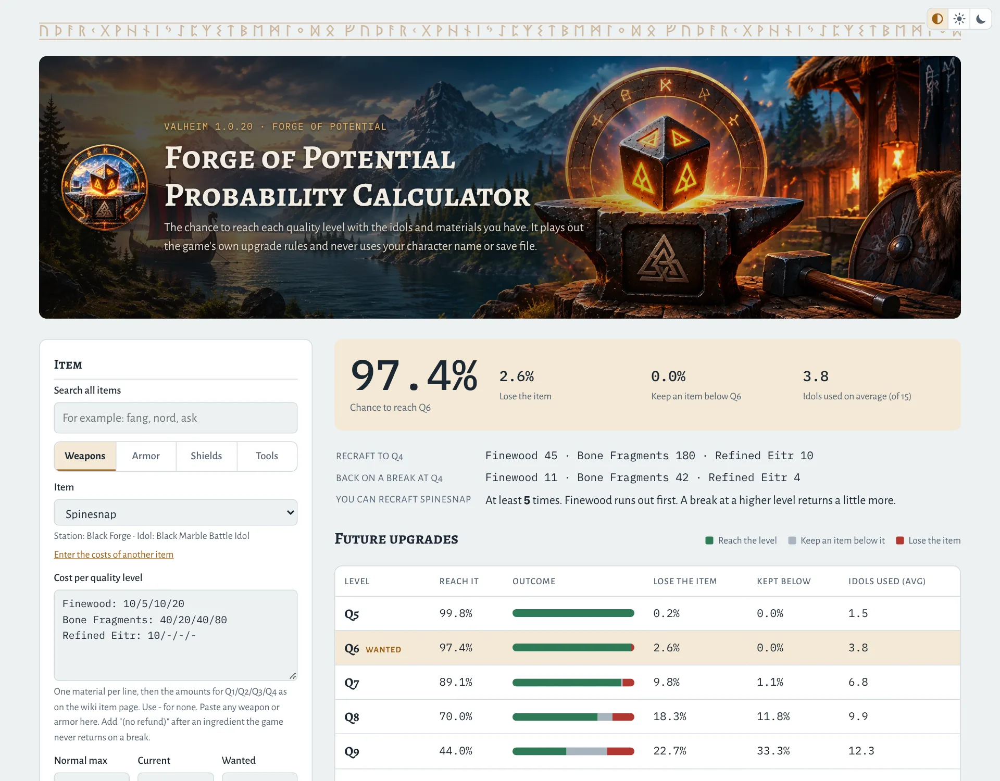

# Forge of Potential Probability Calculator

<picture>
  <source media="(prefers-color-scheme: dark)" srcset="docs/screenshot-dark.webp">
  
</picture>

A calculator for the Forge of Potential in Valheim 1.0.20. Enter an item, its current and wanted level, your idols and your materials, and the page shows the chance to reach each level, the chance to lose the item, and how many idols you will use on average.

**Live page:** https://szsahin.github.io/fop-calculator/

The calculator never reads your character file or uses your character name. It shows the chances a player has without knowing the game's hidden seeds, so it does not remove the risk the Forge is designed to have.

Unofficial fan tool. Not affiliated with or endorsed by Iron Gate AB.

## How the calculation works

The page plays out the game's own upgrade rules for 40,000 simulated players with unknown names and counts the results.

- Each attempt uses one idol of the item's tier and succeeds when the roll is 0.65 or less. A failure destroys the item.
- Since patch 1.0.20 each attempt uses a seed stored in the character. The first attempt at a level starts from a seed made from the character name, the item and the level. Because these first-attempt seeds of consecutive levels are consecutive numbers, the first rolls are linked: on first attempts, one copy almost never climbs more than 4 levels in a row.
- After every attempt, success or failure, the game stores a new, unrelated seed for that item and level, so a recrafted copy gets new results.
- On a break, the game returns 35% of the base recipe plus the upgrade cost of the level the item had, rounded up. Above level 4, each extra level counts as half a level in that cost. Idols are never returned.

The results are the same every time for the same inputs. Each number can differ from the exact value by up to about 0.5 percentage points.

### How the rules were checked

The rules come from the game code as read by [Forge Oracle](https://github.com/papptimus/Forge-Oracle) and [ValheimSaveParser](https://github.com/Melichor/ValheimSaveParser). The code in this repository is a separate implementation written from those descriptions. It was checked in game with a new test character:

- 48 recorded hammer attempts were replayed exactly from the character name and the rules, including every seed the game stored.
- The result of a new attempt was worked out before it was made, and the game gave that result.
- The materials returned by four hammer breaks at Q3, Q4, Q5 and Q7 matched the 35% rule (the 50% value on some wiki pages is wrong).

These results are stored in the tests, so any later change can be checked against them.

## Use it

Open `index.html` in a browser, or use the live page. No build step and no server are needed. Opened from disk, the footer shows "(local copy)" instead of the version number, because browsers do not let a page opened from disk read the `VERSION` file.

To serve it locally, any static web server works, for example:

```
python3 -m http.server 8000
```

## Files

| Path | Content |
|---|---|
| `index.html` | Calculator page |
| `guide.html` | "What the percentages mean": a short guide for players who do not work with statistics |
| `css/style.css` | One stylesheet for both pages |
| `js/items.js` | Item presets |
| `js/forge-model.js` | Game rules and simulation (no page code) |
| `js/app.js` | Calculator page |
| `js/version.js` | Reads `VERSION` and shows it in the footer of both pages |
| `js/theme.js` | Color theme picker (Auto, Light, Dark) on both pages; keeps the choice in the browser |
| `js/links.js` | On the live site only: shows short addresses (`guide` instead of `guide.html`) |
| `VERSION` | The version number ([Semantic Versioning](https://semver.org)) |
| `CHANGELOG.md` | Changes in each version |
| `img/` | Icons, the header banner and logo, and the stone picture used in the guide |
| `docs/` | Screenshots for this README |
| `fonts/` | Font files and their licenses |
| `tests/forge-model.test.js` | Tests |
| `.github/workflows/release.yml` | Runs the tests on every push and creates the releases |

## Add or correct an item

The presets cover all 227 items that the Forge of Potential can upgrade in Valheim 1.0.20. To correct one, or to add an item from a later game version, edit its entry in `ITEMS` in `js/items.js`:

```js
{ type: "Weapons", name: "Spinesnap", station: "Black Forge", idol: "Black Marble Battle Idol", maxq: 4,
  costs: "Finewood: 10/5/10/20\nBone Fragments: 40/20/40/80\nRefined Eitr: 10/-/-/-" },
```

- `type`: the tab the item is listed under: `Weapons`, `Armor`, `Shields` or `Tools`.
- `idol`: the item's Forge of Potential idol. The biome group in the list (Meadows, Black Forest, … Deep North) comes from the idol's tier, so it needs no field of its own.
- `costs`: one ingredient per line, then the amounts for Q1/Q2/Q3/Q4 as on the item's wiki page. Use `-` for none.
- Add `(no refund)` after an ingredient the game never returns on a break, for example `Liquid Frost: 5/-/-/- (no refund)`.
- For an item made from another item (for example the Frostfire Sword from a Nord Sword), list the base item's materials as extra Q1 lines marked `(no refund)`. A material may appear on two lines; both use the same stock.
- `maxq`: the highest level the crafting station can reach.
- `note` (optional): text shown under the item list.

Any other item can also be entered on the page directly with "Enter the costs of another item".

## Run the tests

Needs [Node.js](https://nodejs.org) 18 or newer, no packages:

```
node --test tests/forge-model.test.js
```

The tests check the random generator, the replay of the real test character's attempts, the refunds counted in game, the linked first attempts, the simulation results and every item preset. If a test fails after a game patch, check the game first; only then change the expected values.

## Sources and credits

- Forge mechanics: [Forge Oracle](https://github.com/papptimus/Forge-Oracle) (MIT) and [ValheimSaveParser](https://github.com/Melichor/ValheimSaveParser).
- Item costs: the [Valheim wiki](https://valheim.weirdgloop.org/w/Forge_of_Potential) and the 1.0.20 game data in ValheimSaveParser.
- Fonts: Alegreya SC and Alegreya Sans (Huerta Tipográfica), IBM Plex Mono (IBM) and Noto Sans Runic (the Noto Project), under the SIL Open Font License 1.1. The rune bands on both pages are drawn from Noto Sans Runic and stored as a picture in `css/style.css`.
- Header banner and logo: created by szsahin with ChatGPT.

## License

The code is released under the [MIT License](LICENSE). The fonts keep their own license (see `fonts/`).
